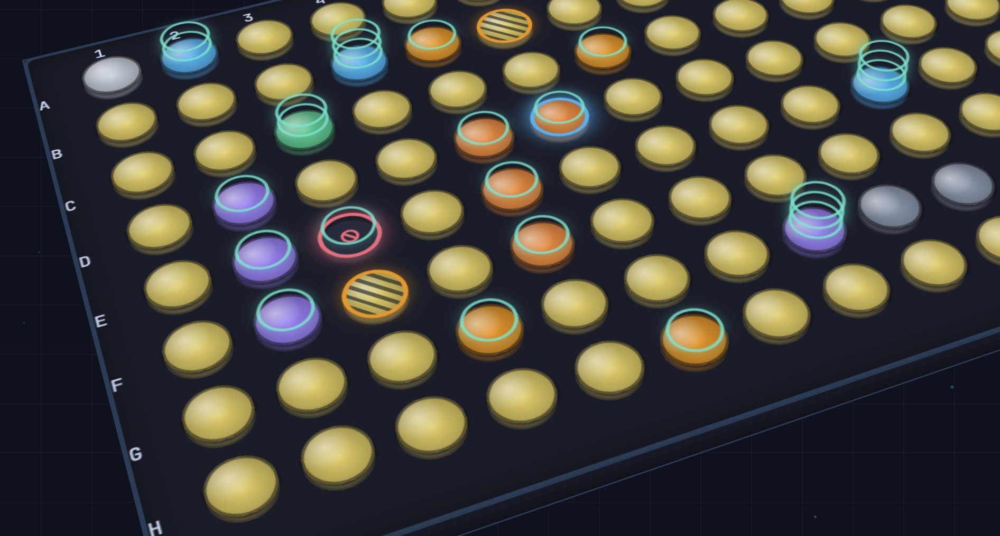

# Source of Truth Systems

Explore how a life sciences team follows a sample through its workflow, reviews changing results and finds the files behind a finding. **Source of Truth for Life Sciences** is the working application in this repository: a visual, interactive example for studying and extending these information relationships.

The Corridor connects work from intake to reporting. The Plate brings a sample's history, quality, consent and related files into one view. Desktop adds specimen comparisons, source records, cohort rules and presentations; mobile concentrates on the Corridor and Plate. [Try the working application](https://kindlight.ai), or run the bundled examples below. [Fixture provenance](docs/fixture-provenance.md) explains the example findings and policy assumptions.



## Run the complete local example

Install Git, Node **22.15 or newer within 22.x**, and Docker with Compose. The recipe supplies locked application dependencies and a PostgreSQL database owned by this clone.

```sh
git clone https://github.com/driftframestudios/source-of-truth-systems.git
cd source-of-truth-systems
node scripts/clone.mjs configure --port 3000
node scripts/clone.mjs up
```

Open `http://localhost:3000`. Use **Guide** to choose a question or **Watch walkthrough**, or explore the Corridor and Plate directly. C3's Sample history shows **Stored history**. Source title, description and tag edits persist in an isolated visitor workspace for up to 24 hours; other workflow edits last for the current browser session.

`node scripts/clone.mjs stop` preserves the database. Run `up` to return. [Getting started](docs/getting-started.md) explains configuration and prerequisites; [local operations](docs/runbooks/local-postgresql-clone.md) covers backup, restore and an explicitly confirmed reset.

For interface-only exploration or hot reload, install pnpm **10.34.3**, run `pnpm install --frozen-lockfile`, then `npm run dev:source`. Open `http://localhost:8443`; this lighter route uses bundled examples and browser-local edits.

## Choose a route

| I want to… | Start here |
| --- | --- |
| Explore the app or troubleshoot local startup | [Getting started](docs/getting-started.md) |
| Understand state, scenes and retained edits | [Application source](src/app/README.md) |
| Choose persistence or understand database trade-offs | [Database choices](docs/database-choices.md): PostgreSQL, bundled examples and optional specialist stores |
| Inspect GraphQL or the current stored-data contracts | [Server and data](server/README.md) |
| Deploy the example | [Node hosting](docs/deployment.md) |
| Make a focused change | [Contributing](CONTRIBUTING.md) and [test selection](tests/README.md) |
| Browse design decisions and interaction contracts | [Documentation](docs/README.md) |

## Verify a change

A small check is available immediately after installing dependencies:

```sh
npm run test:mobile
```

It checks the Corridor gesture owner; a visible interface change also needs an affected-view browser check. For a shared change or release candidate, the complete ordinary route is:

```sh
npm run typecheck
npm run check:3d
npm run build
npm test
pnpm exec playwright install chromium
npm run test:browser
```

Build before the aggregate tests: API and startup checks inspect the generated outputs. The browser suite owns port 3200. Actual PostgreSQL proof is an explicitly selected [isolated database route](docs/postgresql.md#focused-evidence), separate from ordinary tests. [Tests](tests/README.md) explains narrower choices, prerequisites and result boundaries.

Main pull requests receive the fitting **Verify change** route and committed-tree scan. Optional deeper checks and the disabled [branch protection profiles](.github/rulesets/README.md) retain their own scope and activation. The docs branch uses a pinned data-only verification route after the separately approved Pages transition.

## Deploy or adapt

The complete application runs on Node. `npm run build` creates browser files and private server data; `npm start` serves both with GraphQL. The public edition supports PostgreSQL and bundled examples. Other Node hosts can use the build/start contract and earn their own receiving-host check. A static host serves browser assets but does not provide the application's API or durable workspace. [Deployment guide](docs/deployment.md)

The PostgreSQL adapter and [Compose/native setup](docs/runbooks/local-postgresql-clone.md) persist Plate history and expiring Source metadata workspaces. Each clone owns its local data and generated credentials. [Database choices](docs/database-choices.md) explains the current contract and optional property-graph, RDF or object-store extensions.

The ordinary Node build also serves **Developer docs** at `/docs/`, opened in a separate tab so current work stays mounted. `npm run build:foundation` builds the same admitted articles at site root in `dist-foundation/`; publishing that static site remains a separate owner action. The source-derived GraphQL reference and all documentation profiles share [one content manifest](docs/content-manifest.json).

The repository retains its Figma Make entry scripts and Vite adapter. They provide source configuration for a fresh Make session; a new import still needs verification in that session. The pinned container recipe has its own fresh-clone and recovery proof; a receiving managed host still needs a deployment observation.

## Dependencies and continuation

React, TypeScript, Vite, Tailwind and Motion shape the browser experience. The Node server uses GraphQL Yoga and the `pg` PostgreSQL driver; those dependencies remain outside the browser bundle. [Shared contracts](shared/README.md) preserve record and permission meaning across both sides. The root package and lockfile own the toolchain.

Extend an existing state or command owner before adding a parallel store. Keep synthetic examples useful, preserve current interactions, and test the behavior your change affects. [Local skills and runbooks](AGENTS.md) support human and AI-assisted development without access to another workspace. Public issues and pull requests are the contribution route; [CONTRIBUTING](CONTRIBUTING.md) explains review and how accepted contributions retain credit.

## Credit and support

Created by Vikrant Varun Kudesia · Driftframe Studios, LLC. Built with Figma Make (Claude Opus 5.5) and ChatGPT/Codex (GPT-6 Astra), using custom coding harnesses from kindlight.systems. [Attributions](ATTRIBUTIONS.md) identifies component, image and font provenance. The [MIT license](LICENSE) retains the owner's exact notice.

Use [Support](SUPPORT.md) for questions and reproducible bugs, and [Security](SECURITY.md) for a sensitive finding. The [community conduct policy](CODE_OF_CONDUCT.md) applies to repository discussions.
