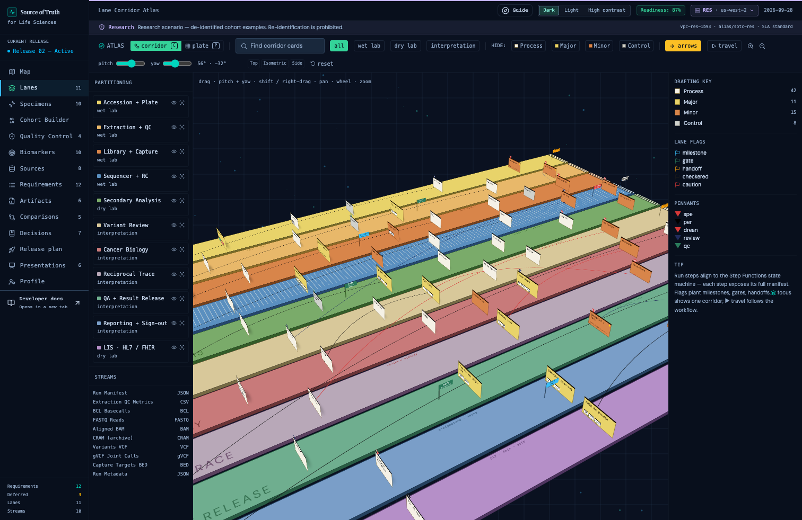
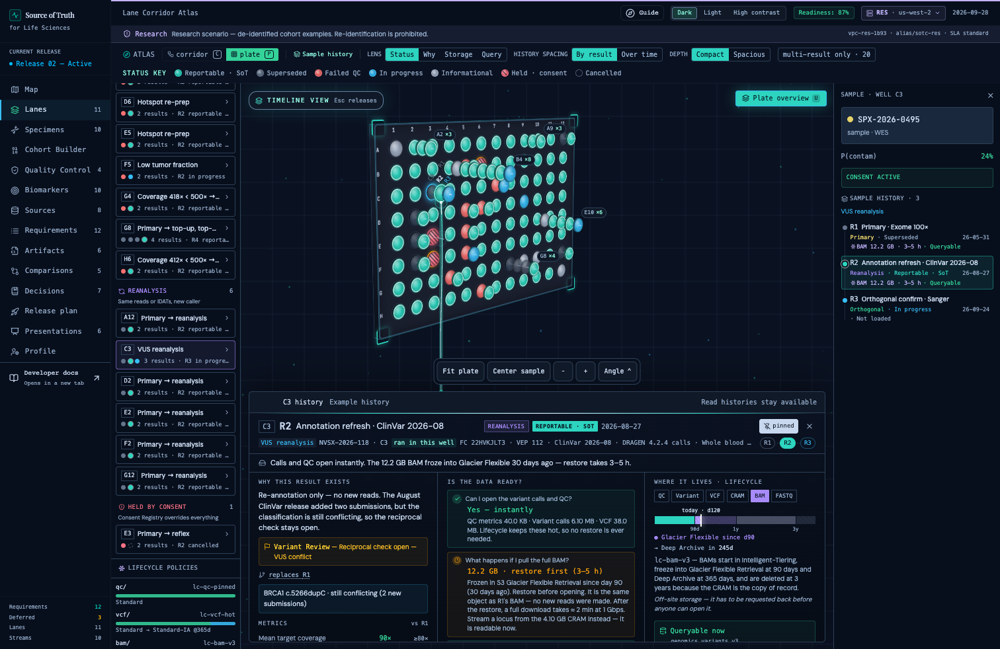
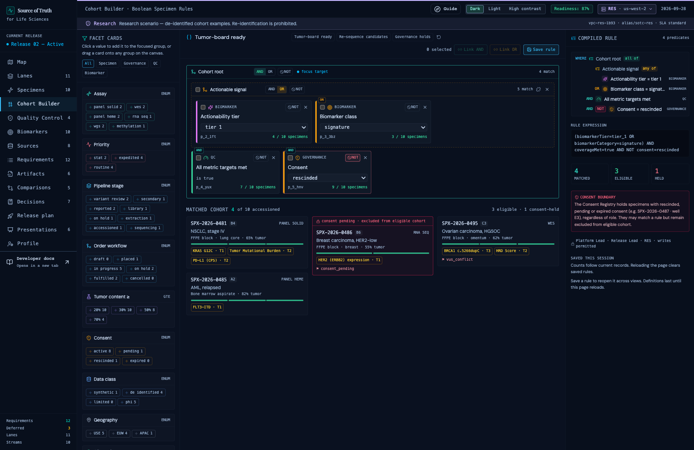
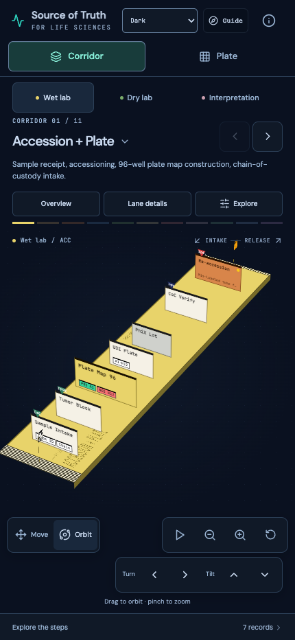
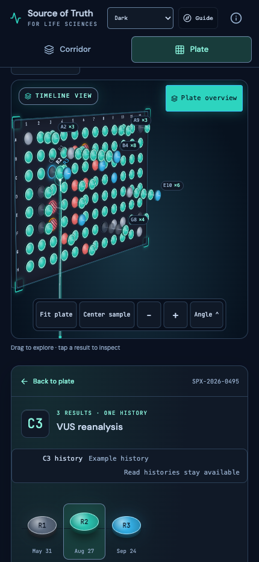

# Source of Truth Systems

Explore how a life sciences team follows a sample through its workflow, reviews changing results and finds the files behind a finding. **Source of Truth for Life Sciences** is the working application in this repository: a visual, interactive example for studying and extending these information relationships.

Use the working components as a starting point for information-dense tools, with responsive layouts, notifications, error recovery, color themes and interactive 3D views already connected. Explore with bundled examples or PostgreSQL-backed records, then adapt the data and Figma Make configuration for your own project.

- [Try the working application](https://kindlight.ai), or run the bundled examples below.
- [Explore the developer documentation](https://kindlight.foundation) to find the code behind the experience.
- [Read the fixture provenance](docs/fixture-provenance.md) for the example findings and policy assumptions.

## Explore the workflows

### Follow work through the Corridor

See how work moves from sample intake to reporting. The Corridor keeps each step beside its supporting records, so you can follow the process and inspect what happens along the way.



### Understand a sample's history

Select a well to compare its results over time. The Plate brings sample history, quality, consent and related files together, helping you investigate questions such as why a sample was rerun.



### Build and explore cohort rules

The working rule builder lets you combine conditions and see which example specimens match. Desktop also gives you room to compare specimens, inspect source records and assemble presentations around the findings.



### Explore the Corridor and Plate on mobile

Mobile puts the Corridor and Plate within reach of direct touch controls. Follow the workflow, select a well and open its 3D Sample history; the selected view and records stay with you as the layout changes.

<p>
  
  
</p>

## Run the complete local example

Clone this public repository to run it locally, or explore the [live application](https://kindlight.ai).

Install Git, Node **22.15 or newer within 22.x**, and Docker with Compose. The recipe supplies locked application dependencies and a PostgreSQL database owned by this clone.

```sh
git clone https://github.com/driftframestudios/source-of-truth-systems.git
cd source-of-truth-systems
node scripts/clone.mjs configure --port 3000
node scripts/clone.mjs up
```

Open `http://localhost:3000`. Use **Guide** to choose a question or **Watch walkthrough**, or explore the Corridor and Plate directly. C3's Sample history shows **Stored history**. Source title, description and tag edits persist in an isolated visitor workspace for up to 24 hours; other workflow edits last for the current browser session.

`node scripts/clone.mjs stop` preserves the database. Run `up` to return. [Getting started](docs/getting-started.md) explains configuration and prerequisites; [local operations](docs/runbooks/local-postgresql-clone.md) covers backup, restore and an explicitly confirmed reset.

For interface-only exploration or hot reload, install pnpm **10.34.3**, run `pnpm install --frozen-lockfile`, then `npm run dev:source`. Open `http://localhost:8443`; this lighter route uses bundled examples and browser-local edits.

## Choose a route

| I want to… | Start here |
| --- | --- |
| Explore the app or troubleshoot local startup | [Getting started](docs/getting-started.md) |
| Understand state, scenes and retained edits | [Application source](src/app/README.md) |
| Choose persistence or understand database trade-offs | [Database choices](docs/database-choices.md): PostgreSQL, bundled examples and optional specialist stores |
| Inspect GraphQL or the current stored-data contracts | [Server and data](server/README.md) |
| Deploy the example | [Node hosting](docs/deployment.md) |
| Make a focused change | [Contributing](CONTRIBUTING.md) and [test selection](tests/README.md) |
| Browse design decisions and interaction contracts | [Documentation](docs/README.md) |
| Guide an AI collaborator through a focused change | [Repository skills](AGENTS.md#continue-a-collaboration) |
| Follow a repeatable development or delivery procedure | [Runbooks](docs/runbooks/README.md) |

## Work with an AI collaborator

The repository skills give an AI collaborator practical guidance for recurring work, such as checking code and release files for exposed API keys, preserving unfinished edits and choosing tests that exercise the behavior being changed. They keep useful development practices close to the code so a new collaboration can start with context.

Companion runbooks turn those practices into repeatable steps for making changes, checking dependencies, recovering data and delivering a release. Use the [skills index](AGENTS.md#continue-a-collaboration) to choose a method and the [runbook index](docs/runbooks/README.md) to follow an established procedure. Both travel with your clone and can evolve with your project.

## AI-readable documentation and indexing

The prepopulated [llms.txt](llms.txt) gives AI collaborators a concise route into the source documentation as soon as they open the repository. Its relative links work within the clone; the application and documentation builds also generate hosted `llms.txt` and `llms-full.txt` files from the maintained documentation sources.

Before deploying, create or adapt your site's `robots.txt` to reflect your own indexing preferences. This application's build generates its default from `robots.index` in [.figma/make/site.json](.figma/make/site.json); the standalone documentation build generates its own allow-all policy. Review the emitted file for each site you publish. The [deployment guide](docs/deployment.md) identifies the build and hosting routes.

## Verify a change

A small check is available immediately after installing dependencies:

```sh
npm run test:mobile
```

It checks the Corridor gesture owner; a visible interface change also needs an affected-view browser check. For a shared change or release candidate, the complete ordinary route is:

```sh
npm run typecheck
npm run check:3d
npm run build
npm test
pnpm exec playwright install chromium
npm run test:browser
```

Build before the aggregate tests: API and startup checks inspect the generated outputs. The browser suite owns port 3200. Actual PostgreSQL proof is an explicitly selected [isolated database route](docs/postgresql.md#focused-evidence), separate from ordinary tests. [Tests](tests/README.md) explains narrower choices, prerequisites and result boundaries.

Main pull requests receive the fitting **Verify change** route and committed-tree scan. Optional deeper checks retain their own scope. The [branch and tag protection contracts](.github/rulesets/README.md) preserve accepted source; the docs branch uses its pinned data-only verification route.

## Deploy or adapt

The complete application runs on Node. `npm run build` creates browser files and private server data; `npm start` serves both with GraphQL. The public edition supports PostgreSQL and bundled examples. Other Node hosts can use the build/start contract and earn their own receiving-host check. A static host serves browser assets but does not provide the application's API or durable workspace. [Deployment guide](docs/deployment.md)

The PostgreSQL adapter and [Compose/native setup](docs/runbooks/local-postgresql-clone.md) persist Plate history and expiring Source metadata workspaces. Each clone owns its local data and generated credentials. [Database choices](docs/database-choices.md) explains the current contract and optional property-graph, RDF or object-store extensions.

The ordinary Node build also serves **Developer docs** at `/docs/`, opened in a separate tab so current work stays mounted. `npm run build:foundation` builds the same admitted articles at site root in `dist-foundation/`. The [tagged documentation release](docs/runbooks/tagged-documentation-release.md) builds one reviewed artifact and explicitly activates those same files on Pages. The source-derived GraphQL reference and all documentation profiles share [one content manifest](docs/content-manifest.json).

The repository retains its Figma Make entry scripts and Vite adapter. They provide source configuration for a fresh Make session; a new import still needs verification in that session. The pinned container recipe has its own fresh-clone and recovery proof; a receiving managed host still needs a deployment observation.

## Dependencies and continuation

React, TypeScript, Vite, Tailwind and Motion shape the browser experience. The Node server uses GraphQL Yoga and the `pg` PostgreSQL driver; those dependencies remain outside the browser bundle. [Shared contracts](shared/README.md) preserve record and permission meaning across both sides. The root package and lockfile own the toolchain.

Extend an existing state or command owner before adding a parallel store. Keep synthetic examples useful, preserve current interactions, and test the behavior your change affects. [Local skills and runbooks](AGENTS.md) support human and AI-assisted development without access to another workspace. Public issues and pull requests are the contribution route; [CONTRIBUTING](CONTRIBUTING.md) explains review and how accepted contributions retain credit.

## Credit and support

Created by Vikrant Varun Kudesia · Driftframe Studios, LLC. Built with Figma Make (Claude Opus 5.5) and ChatGPT/Codex (GPT-6 Astra), using custom coding harnesses from kindlight.systems. [Attributions](ATTRIBUTIONS.md) identifies component, image and font provenance. The [MIT license](LICENSE) retains the owner's exact notice.

Use [Support](SUPPORT.md) for questions and reproducible bugs, and [Security](SECURITY.md) for a sensitive finding. The [community conduct policy](CODE_OF_CONDUCT.md) applies to repository discussions.
